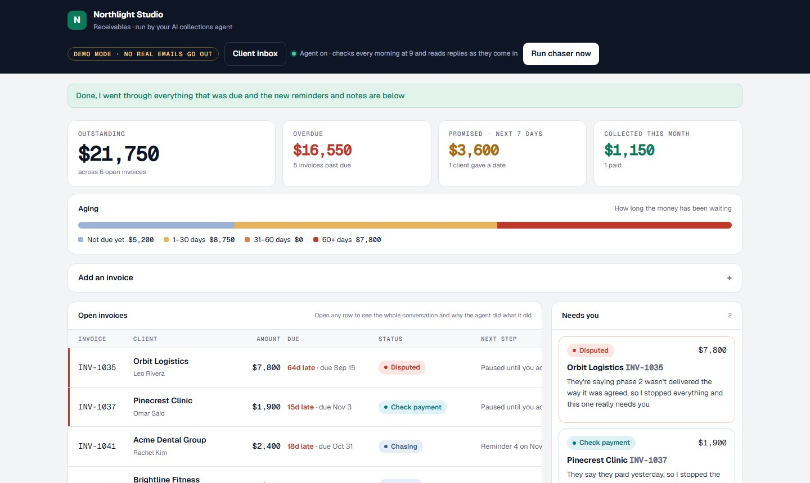
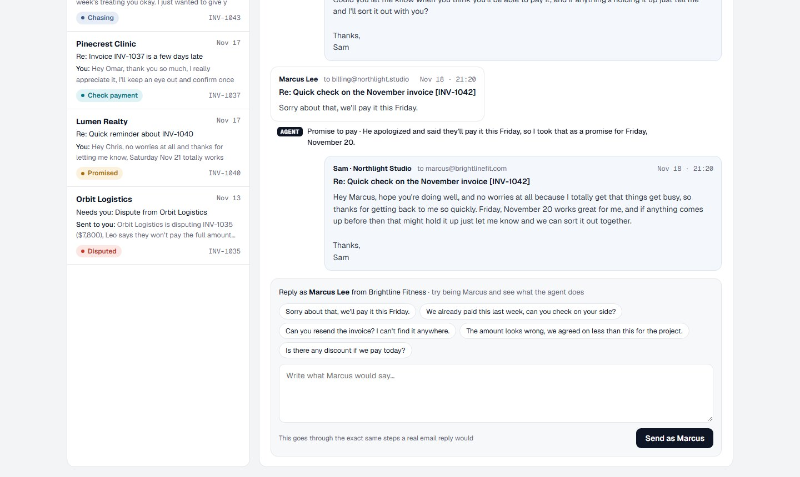
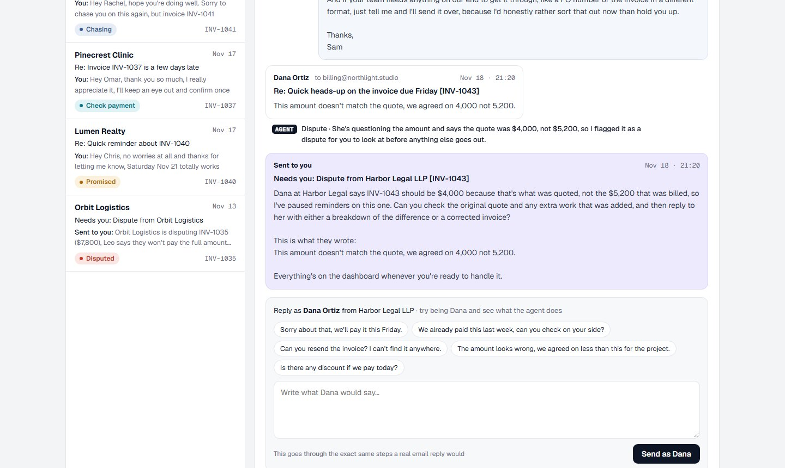

# n8n Invoice Chaser

An n8n agent that chases late invoices for you. Every morning it writes each client a reminder in your own voice, and when a client answers it reads the reply and works out what they meant, so a promise to pay pauses the reminders until that date, a "we already paid" asks you to check the bank, and a dispute stops everything and comes to you instead of getting an automatic answer.



## What it does

- Picks every invoice that's due for a nudge and writes the email with AI. It gets a little firmer the later the invoice is: a heads-up before the due date, then friendly, then clear, then firm, and after four reminders it stops and hands the invoice to you
- Reads client replies and sorts them into a promise to pay, already paid, lost the invoice, a dispute, a question, or out of office
- Decides what happens next with plain code, not the AI: pause until the promised date and check back the day after, resend the link, flag it for you, or just log it
- Sends you a summary every Monday morning with what came in and what's still out
- Keeps a dashboard with what you're owed, how late it is, and only the few invoices that actually need you



## How it works

The AI writes the emails and reads the replies, and both calls go through the HTTP Request node to the Messages API with a JSON schema, so the answer always comes back as fields the workflow can use. Everything that changes an invoice, like the next reminder date or the status, is decided afterwards in a Code node, so the AI never gets to move money or dates on its own.

The emails are written in the owner's voice, which is described in `nodes/_shared.js`. That's the part to change if you want it to sound like you.



## Workflows

| File | What it does |
|---|---|
| `workflows/0-setup.json` | Creates the Data Tables and loads the demo invoices, plus a reset link for testing |
| `workflows/1-daily-chaser.json` | Every day at 9: picks what's due, writes the reminders, sends them, updates the invoices |
| `workflows/2-reply-reader.json` | Reads each client reply and decides what to do with it |
| `workflows/3-dashboard.json` | The dashboard, adding an invoice, marking one paid, and the demo client inbox |
| `workflows/4-monday-summary.json` | The Monday morning summary |

## Setup

You need a self-hosted n8n with Data Tables (I built it on n8n 2.48) and an Anthropic API key.

1. Import the five files from `workflows/` into n8n
2. Open the **AI writes reminders** node in the daily chaser and the **AI reads the reply** node in the reply reader, and pick your Anthropic credential on both
3. Publish all five workflows
4. Create the tables and the demo data:
   ```bash
   curl -X POST http://localhost:5678/webhook/invoice-chaser-setup
   ```
5. Open `http://localhost:5678/webhook/invoices` and click **Run chaser now**

## Demo mode and real email

It starts in demo mode (`"emailMode": "demo"` in `config.json`), so no email ever leaves n8n. Everything the agent sends lands in a **Client inbox** page, and you can answer there as the client to see what it does with the reply.

To use real email, set `"emailMode": "real"`, add your SMTP and IMAP credentials to `config.json`, and run `node build.js` again. While `testMode` is `true`, every client email goes to a plus-address of your own mailbox (like `you+acme@yourdomain.com`), so you can try it on real email without writing to real clients.

## Changing it

The workflows are generated from the files in `nodes/`, so edit those and rebuild:

```bash
node build.js
```

`config.json` holds the business name, the owner's name, the currency, the payment link, the AI model, and the email settings.

## License

MIT
